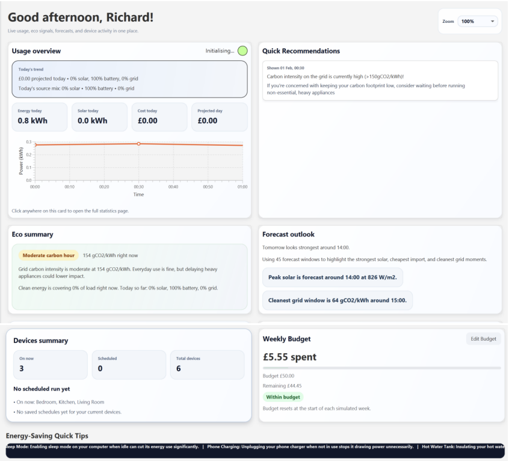
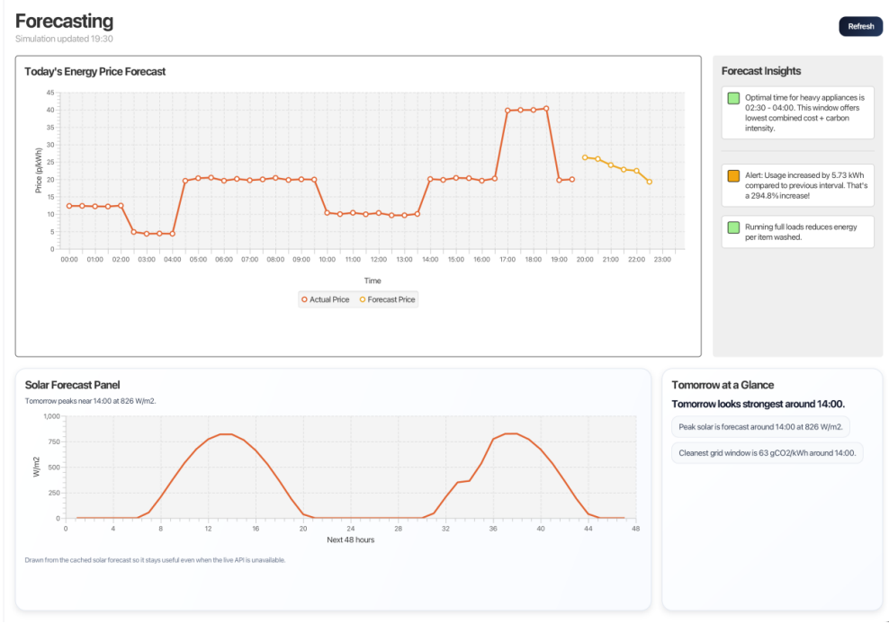
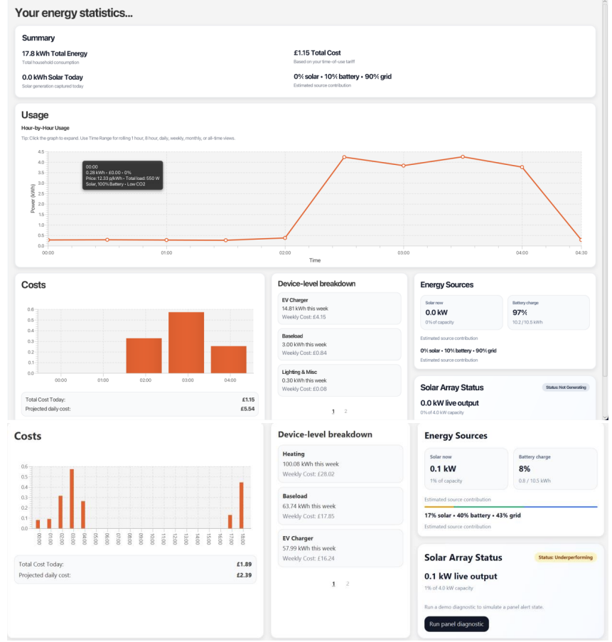
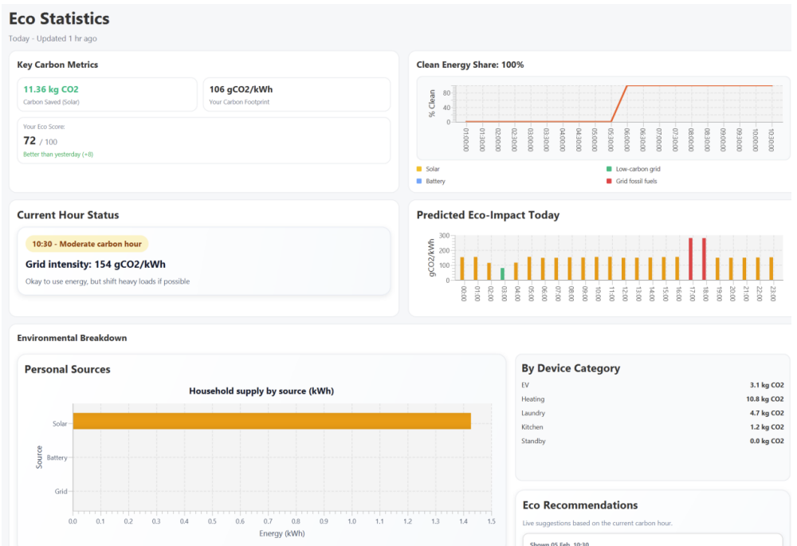
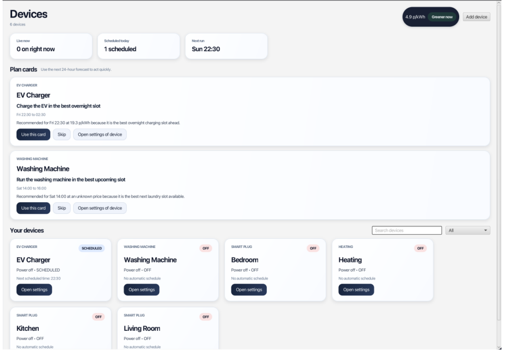
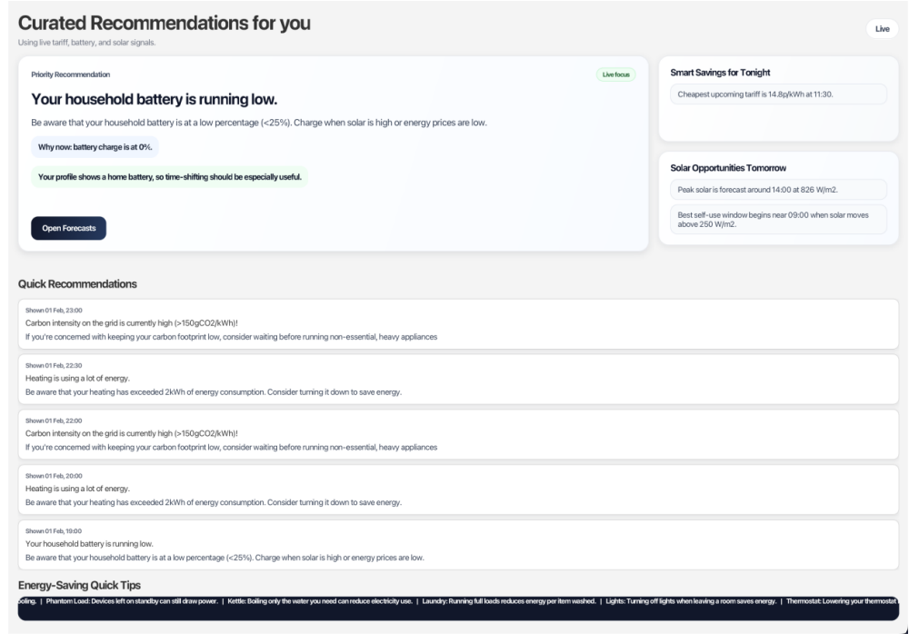
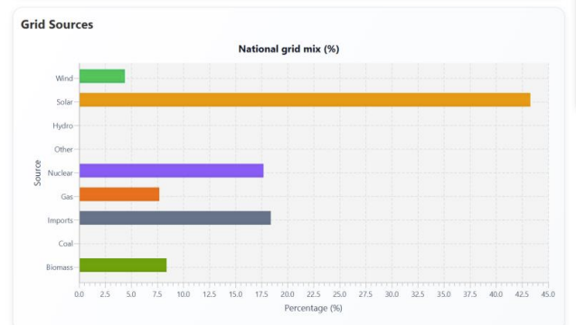

<div align="center">

# ⚡ Lumen

### Understand your energy. Reduce costs. Make greener choices.

**A smart home energy management application that transforms household energy data into real-time insights, forecasts and actionable recommendations.**


*University of Southampton · COMP2300 Software Design & Development Project*

</div>

---


> **Project scope:** Lumen is an academic prototype. Household consumption and connected-device behaviour are simulated; external APIs supply electricity tariff, grid carbon and solar/weather information. It is not connected to physical smart meters or appliances.
>
An almost 250-page report was also produced alongside the project (not included in this repository due to academic confidentiality). Spanning eight deliverables, it documents the entire software development lifecycle, including **problem-space research and thematic analysis (D1), stakeholder analysis and conceptual design (D2), prototyping and evaluation planning (D3), requirements engineering, UML design and project planning (D4), three Agile development sprints covering implementation, testing and iterative improvements (D5-D7), and a final comprehensive usability evaluation with participant testing, data analysis and recommendations (D8)**. The reports also document project management decisions, technical challenges, stakeholder feedback and reflections throughout development.

## Features

- **Energy dashboard:** An at-a-glance view of household consumption, electricity costs, solar generation, grid import and energy-saving suggestions, updated as the simulation advances.
- **Detailed statistics:** Interactive usage graphs, hourly cost breakdowns, device-level comparisons and visualisations of solar, battery and grid energy sources.
- **Forecasting:** Electricity price forecasts, location-based solar forecasts and insights highlighting potentially cheaper or lower-carbon times to use energy.
- **Recommendations and planning:** Contextual tips, forecast-based planning cards and shortcuts that help turn energy information into actions.
- **Device management:** Simulated smart plugs and appliances with power controls, scheduling options and overrides.
- **Budgets and accessibility:** Weekly spending targets and warnings, alongside dark mode, high contrast and other display and accessibility settings.
- **Persistent local data:** SQLite-backed simulation records, API caches, user preferences and device-related data.

## Tech stack

| Area | Technologies |
| --- | --- |
| Language and UI | Java 17, JavaFX 21, FXML, CSS, Scene Builder |
| Data storage | SQLite, JDBC |
| Build and dependencies | Maven |
| External data | Octopus Energy API, Carbon Intensity API, Open-Meteo API |
| Testing | JUnit 5, Maven Surefire |
| Collaboration | Git, GitLab, Jira, Agile/Scrum practices |

## Team and my contributions

**Developed:** Tharun Selva, Paul Bayliss, Callum FitzGerald, Chi Ning and Abdulrahman Ahmado.

**Tharun** and **Paul** were the **group leaders and software developers**, contributing across project management, backend architecture and frontend implementation. 
- **Project leadership:** Organising sprints, allocating and tracking work in Jira, refining user stories and acceptance criteria, prioritising the backlog, coordinating meetings and managing feedback from our supervisor and pilot / user feedback sessions.

This was a **collaborative team project**.

## Screenshots

| Dashboard | Energy Forecasting |
|:---:|:---:|
|  |  |
| **Energy Statistics** | **Eco Statistics** |
|  |  |
| **Device Management** | **Recommendations** |
|  |  |

<details>
<summary><b>Additional screenshot - Grid energy sources</b></summary>



</details>


## Getting started

### Requirements

- **JDK 17 or newer**
- **Maven** (for building or running from source)
- A desktop environment capable of running JavaFX
- Internet access for refreshing live API data

### Option 1: Run the packaged JAR

If a downloadable build has been published under **GitHub Releases**, use that JAR. The original coursework repository also includes `energyapp-1.0-SNAPSHOT.jar` in its root directory.

```bash
java -jar energyapp-1.0-SNAPSHOT.jar
```

JavaFX native dependencies can be platform-specific, so running from source may be more reliable on some systems.

### Option 2: Run from source

Clone the repository using GitHub's **Code** button, then open a terminal in the project root:

```bash
mvn clean javafx:run
```

### Tests and build

```bash
mvn test
mvn clean package
```

Maven creates build output in `target/`. The Shade plugin is configured to package the application with its dependencies.

## Development notes

### How the code is organised

```text
src/main/java/com/energyapp/
  controller/     JavaFX view controllers
  db/             SQLite access, repositories and data services
  model/          Core energy and device models
  service/        Simulation, recommendations, forecasting and refresh logic
  utils/          Shared calculations and helpers

src/main/resources/
  com/energyapp/view/    FXML views and UI assets
  com/css/app.css        Shared application styling
  com/energy_template_db.sqlite   Initial database template

src/test/java/            JUnit tests
pom.xml                   Maven build configuration
```

### Local database and simulation

On first launch, the app copies the bundled `energy_template_db.sqlite` into a writable local database at `~/.energyapp/data/energy_tool.sqlite`. Later launches reuse that local copy rather than replacing it, helping user and application data persist between sessions. Runtime database files should not be committed to version control.

The simulation provides repeatable household usage data for the prototype, while API-backed data is cached in SQLite and refreshed periodically. The app follows a broadly **Model-View-Controller (MVC)** design, keeping UI controllers separate from data access and business logic.

## Original project instructions

The section below is retained from the original University of Southampton GitLab repository as historical contributor/setup guidance. Some references to the university GitLab workflow are specific to the original coursework environment.

---

# How to Use This Repo

### Cloning

You will want to clone in to this Gitlab repository on your own machines using IntelliJ. The best way to do this is inside the IntelliJ Idea application itself.

**Steps:**

1. Navigate to the IntelliJ Idea welcome screen. In top menu, select File > New > Project from Version Control...
2. You will now be on a window titled "Clone Repository". Go to the Gitlab page for the energy app project and select the blue Code button. Copy the HTTPS link and paste it into the box in the clone repository screen.
3. You will now see a screen asking for a token. Press the generate button, which will take you to the Soton Gitlab site. Create a token, ensuring `api` and `read_user` options are ticked.
4. Copy the token that is given to you, and save it somewhere as you can't access it later. Paste that token into the box in the IntelliJ window.
5. Hit trust project, and you should be done! Try running the project to ensure everything worked properly.

### DB rules
- energy_template_db.sqlite is the shared baseline DB
- AppData DB is local only
- no one commits runtime DBs
- if multiple people need DB content changes, one person integrates them into the template DB

### FXML Ground Rules
This section outlines some basic ground rules for creating FXML UI blueprints in SceneBuilder. This is **crucial**, because will ensure we don't hit hard to debug Null errors later.

#### Directory Structure
To ensure Java can find the files it needs, stick to this structure:

- **Java Controllers**: `src/main/java/com/energyapp/controller/`
- **FXML Views**: `src/main/resources/com/energyapp/view/`
- **Images and Assets**: `src/main/resources/com/images/`
    - **Note for images**: *NEVER* use local absolute paths when adding images into the UI of the app. Always save the image to the above path first, and then use it.

#### Setting `fx:id`

It is important to do this so we can reference FXML elements when we write the Java logic for them. In SceneBuilder:

1. Expand the "Code" drop-down, located on the right of the SceneBuilder window
2. Locate the `fx:id` attribute. *Make sure you are not editing the CSS ID which is in Properties*.
3. Change this field to a sensible, descriptive name.

#### Setting Controller Class Paths

This is needed to make sure the FXML files know what Java class controls them. **ONLY do this to the root element of the file you are working on in SceneBuilder**. Do not do this on any other element.

1. Expand the "Controller" drop-down, located in the bottom left of the SceneBuilder window.
2. Locate the `Controller class` attribute. This is normally right at the top.
3. Change this field to `com.energyapp.controller.[AssociatedControllerClassNameGoesHere]`

#### Refreshing Controllers

If you happen to add or rename an `fx:id` in SceneBuilder or manually in the FXML file, you need to update the Java Controller file to make sure it has the correct reference to the element you changed.

Imagine you changed a `Button` to have `fx:id="submitButton"`. Go to the associated controller class, and make sure you have this code:

```java
@FXML
private Button submitButton; // Name must be an exact match to the fx:id
```

## Testing

### Using `App.java` for Test Runs

When you modify `App.java` to test run a feature you have created, make sure you DON'T push your changes to `App.java` to main. The version of `App.java` on main is build specifically to load the main layout and start the time simulation - don't change this unless you are specifically making changes to `App.java`

Therefore, when you modify this file in your own branch, make sure you **do not tick `App.java` when you commit and push**.

## Installation and Execution

### Prerequisites

Ensure you have the following installed on your machine:
- **Java Development Kit 17** (or higher)
- **Maven 3.6.0** (or higher)

### Running via Fat Jar
We've included a fat jar file that you can find in the project root. You can just double-click this and the project should run!

### Running via Command Line
1. Open terminal or cmd
2. Navigate to root directory of project
3. Run this command:
   ```bash
   mvn clean javafx:run
   ```